# ScholarChart · 学术图表

> 学术规范的矢量图表工具 —— 严谨如期刊，干净如现代设计。

**[🌐 在线使用（无需安装）：https://gguioo.github.io/scholarchart/](https://gguioo.github.io/scholarchart/)**

为论文与科研场景设计的纯前端图表引擎：**原生 SVG 渲染、矢量 PDF 导出、期刊幅面预设、色盲安全淡雅配色**，零运行时依赖，双击 `index.html` 即用。


## 为什么造它

学术绘图工具断成两截：

| | 老派（Origin / matplotlib / Visio） | 新派（Figma / ECharts） |
|---|---|---|
| 严谨 | ✅ 矢量、字号规范、可投稿 | ❌ 导 PDF 是截图转位图 |
| 颜值 | ❌ 默认审美停在 2005 年 | ✅ 漂亮 |
| 上手 | ❌ 调一张图一下午 | ✅ 快 |

ScholarChart 站在断层中间：**把期刊规范做成默认值，把淡雅审美做成默认值**，两边都不用妥协。

## 特性

- **纯 SVG 原生渲染** —— 天生矢量，无限缩放无损
- **三种导出**：
  - `PDF · 矢量`：走浏览器打印管线（Chrome/Edge "另存为 PDF"），矢量路径 + 字体嵌入，可直接投稿
  - `SVG`：源文件级导出，可再编辑
  - `PNG`：最高 600 dpi 位图，满足期刊补充材料
- **期刊幅面预设**：单栏 85mm / 1.5 栏 130mm / 全栏 170mm / 全栏方形，毫米级物理坐标
- **学术图面惯例**：左下轴刺、向内刻度、发丝网格、图号图注（"图 1 ……"格式）、数据来源注
- **色盲安全淡雅配色**：基于 Okabe-Ito 色盲安全色系的低饱和柔化，4 套主题
- **零依赖**：无 npm 包、无构建步骤、无网络请求，`file://` 直开可用

## 图表类型

**经典六件套**

| 类型 | 场景 |
|---|---|
| 趋势图 | 多序列时间趋势、置信带、类目/数值轴 |
| 柱状图 | 分组对比、误差棒（±SD）、数值标注 |
| 热力图 | 共现矩阵、相关矩阵、斜排标签、色标 |
| 雷达图 | 多维方法/能力对比 |

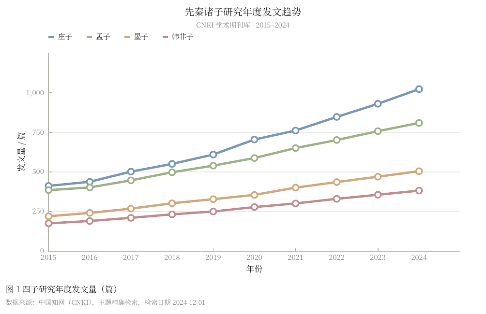
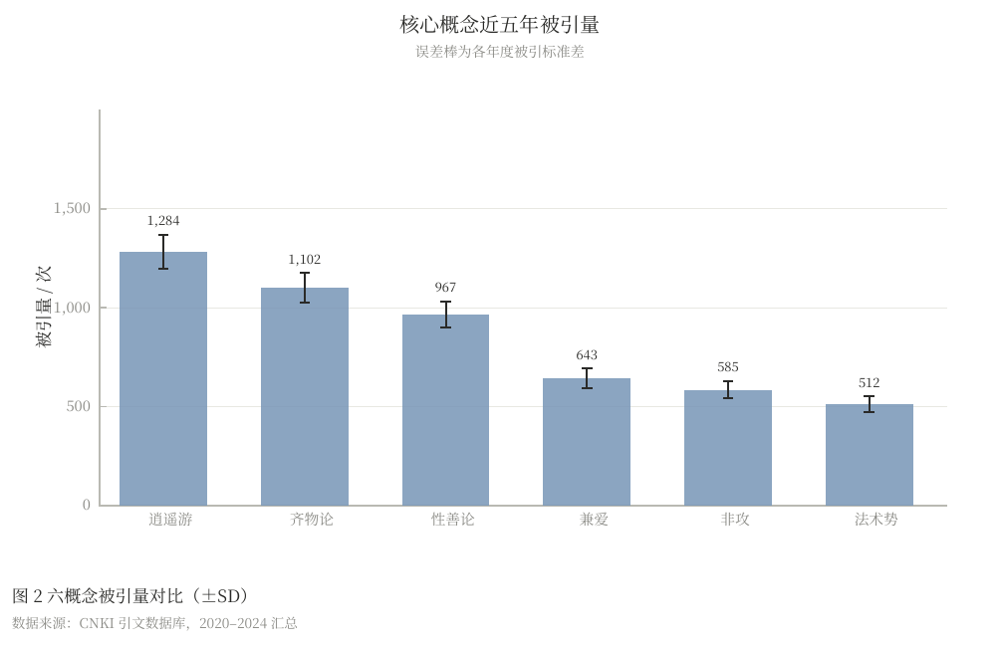
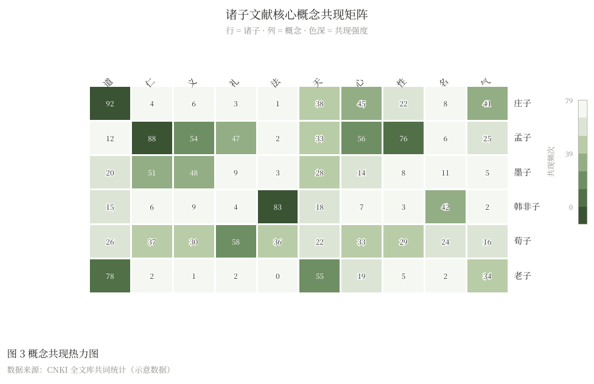
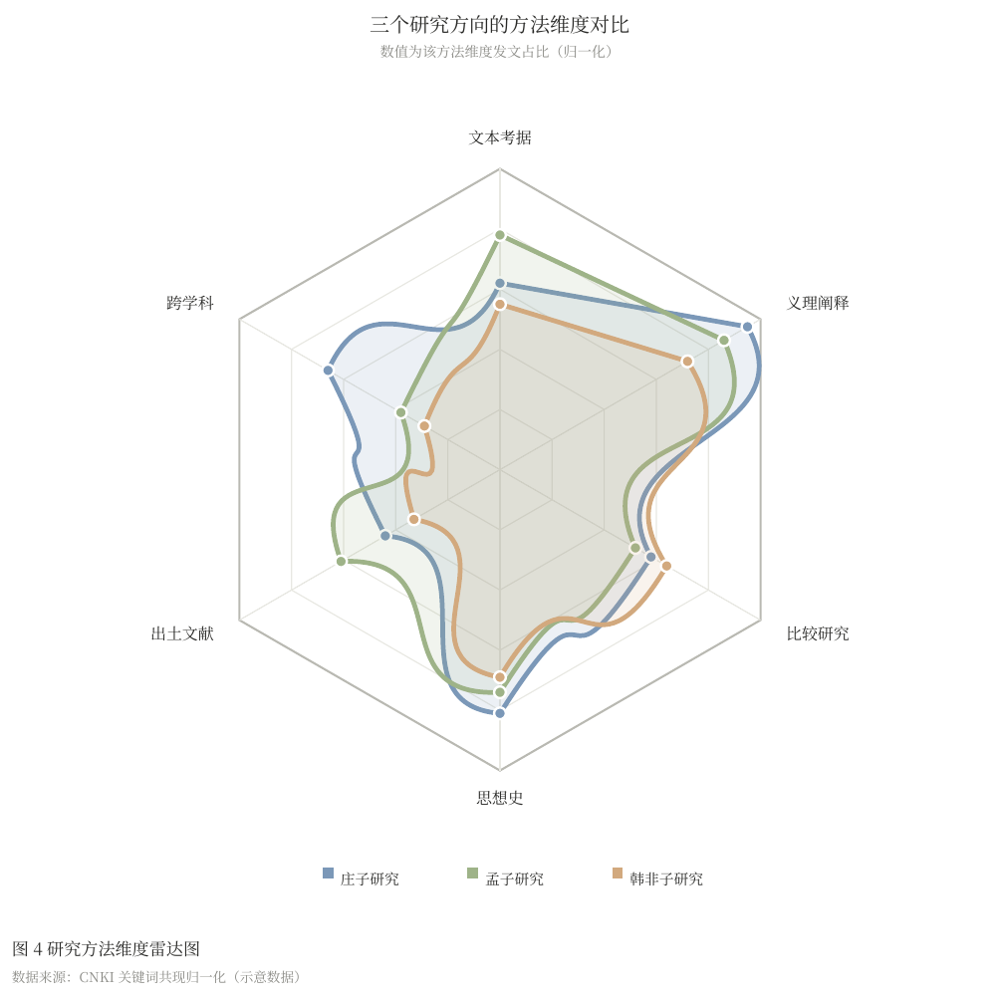

**新一代统计图（第一批）**——近年统计绘图文献里取代老图型的现代方案：

| 类型 | 取代谁 | 出处 |
|---|---|---|
| 雨云图 | 柱状图 + 误差线 | Allen et al. 2019：半小提琴（分布）+ 原始散点（雨）+ 箱线（摘要统计）三合一 |
| UpSet 图 | 韦恩图（集合 > 3 时） | Lex et al. 2014, Nature Methods：交集矩阵 + 规模排序 |
| 坡度图 | 分组柱状图（前后对比） | Tufte：多时间点排名/数值流转，两端标签自动防叠 |
| 战略坐标图 | ——（文献计量专属） | Cobo et al. 2011：密度 × 向心性四象限定位研究主题，气泡 ∝ 文献量，标签防碰撞 |
| 点图 | 分组柱状图 | Cleveland & McGill 1984：位置编码感知精度 > 长度编码 |
| 主题趋势图 | ——（文献计量专属） | Biblioshiny Trend Topic：关键词年度跨度横线 + 峰值年圆点，圆点面积 ∝ 词频 |

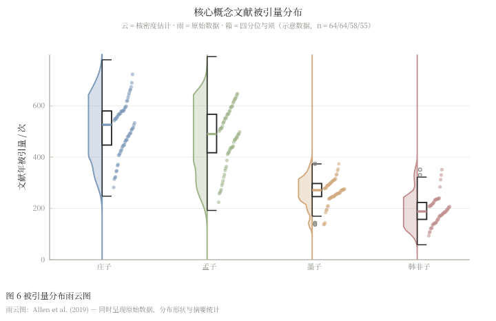
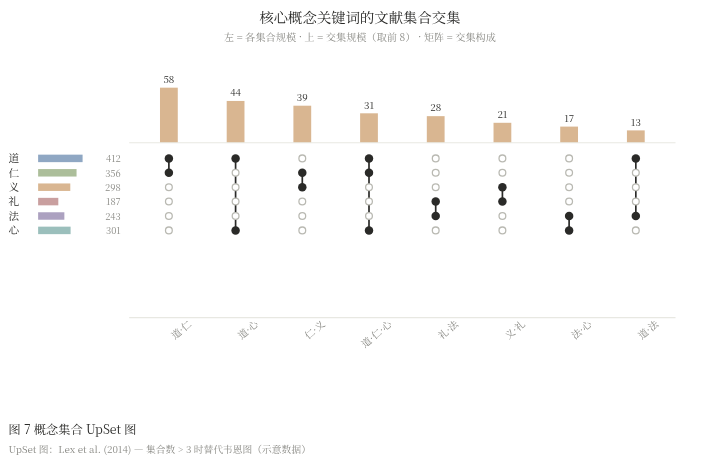
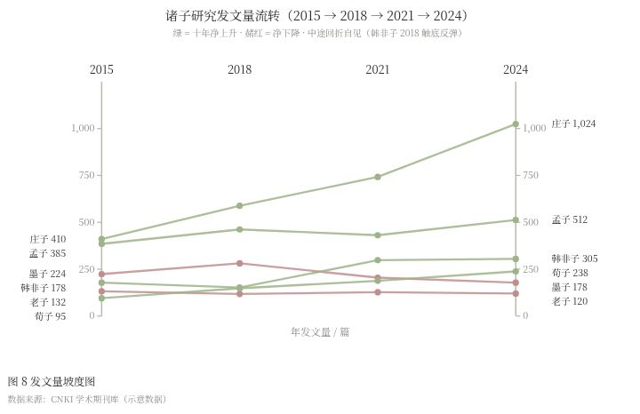
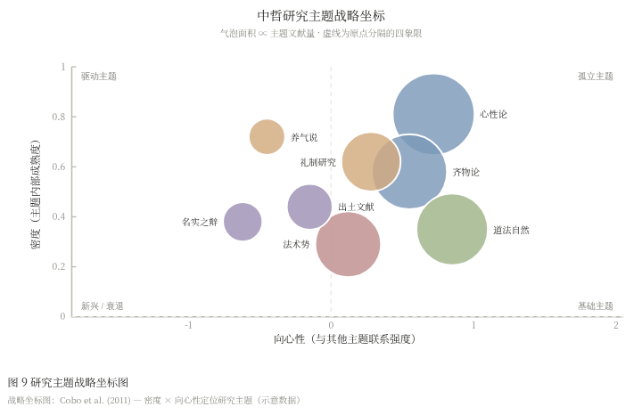
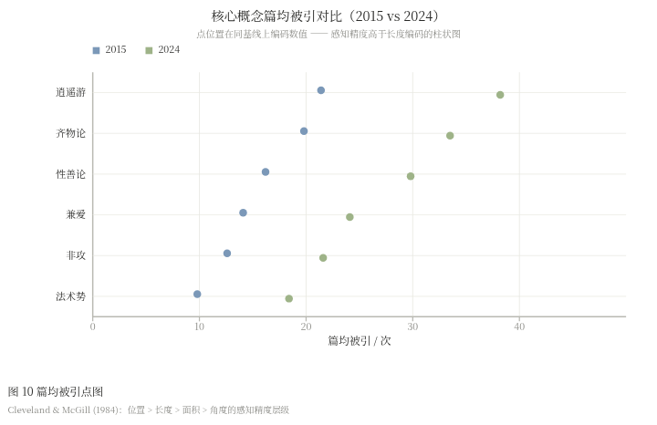
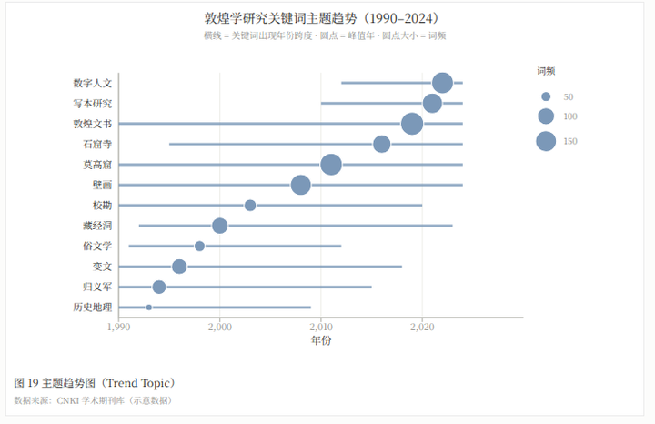

**现代统计学图型（第二批）**——不换皮，真算法：

| 类型 | 干什么 | 统计内核 |
|---|---|---|
| 森林图 | 元分析合并效应 | 逆方差权重 + DerSimonian-Laird 随机效应 + Q / I² / τ² 异质性检验 |
| 估计图 | 两法/两组效应量 | Gardner-Altman 1986 + bootstrap B=3000 百分位 CI（估计统计运动） |
| 山脊图 | 分布随时间漂移 | 高斯核密度（Silverman 带宽）错层叠放 |
| 一致性图 | 两法测量比对 | Bland-Altman 1986, The Lancet：均值-差 + 95% 一致性界限 |
| 生存曲线 | 时间到事件 | Kaplan-Meier 1958 + Greenwood CI + Mantel-Cox log-rank + 风险表 |
| ROC 曲线 | 判别/诊断准确性 | 秩法 AUC（含并列平均秩）+ bootstrap CI + Youden J 最佳切点 |
| Q-Q 图 | 分布正态性检查 | Blom 校正经验分位数 vs Φ⁻¹（A&S 26.2.23），R qqline 法参考线 |
| 时序分解 | 趋势-季节-残差 | 经典加法分解（statsmodels decompose 呈现版），四联面板 |

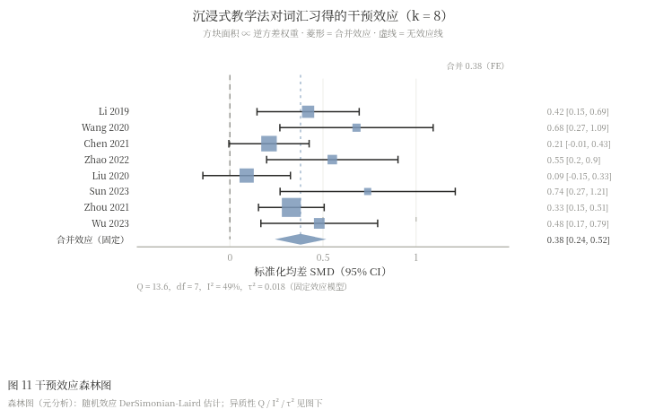
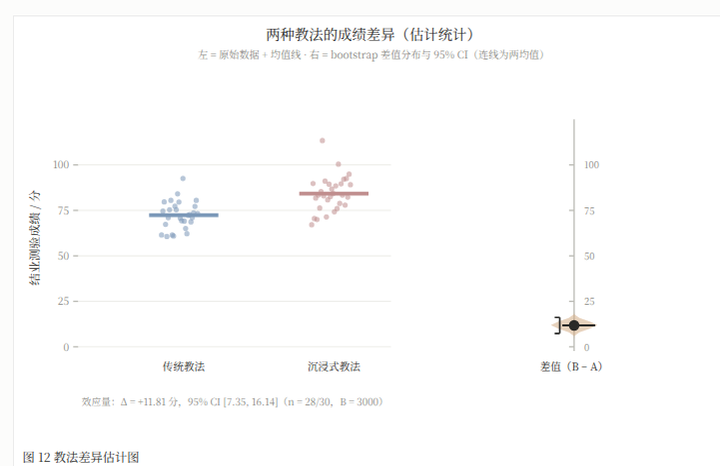
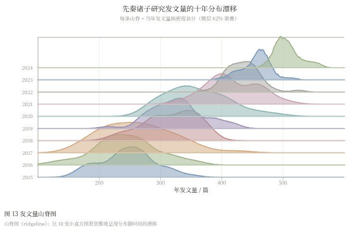
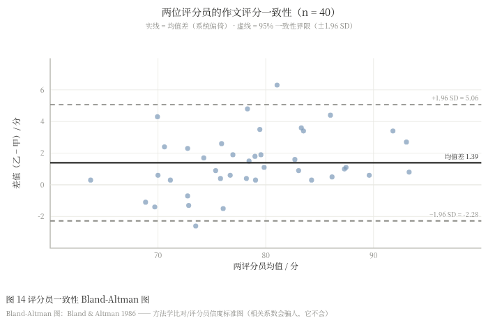
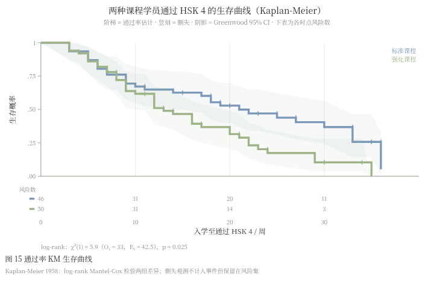
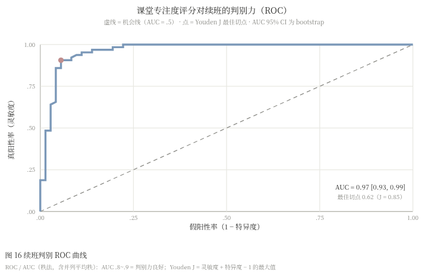
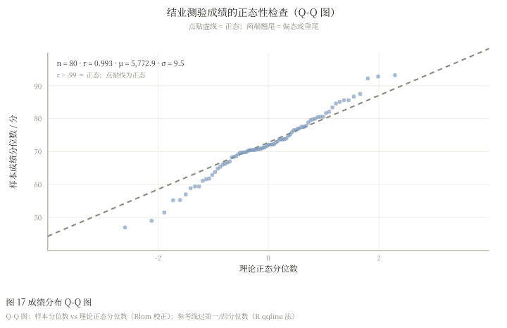
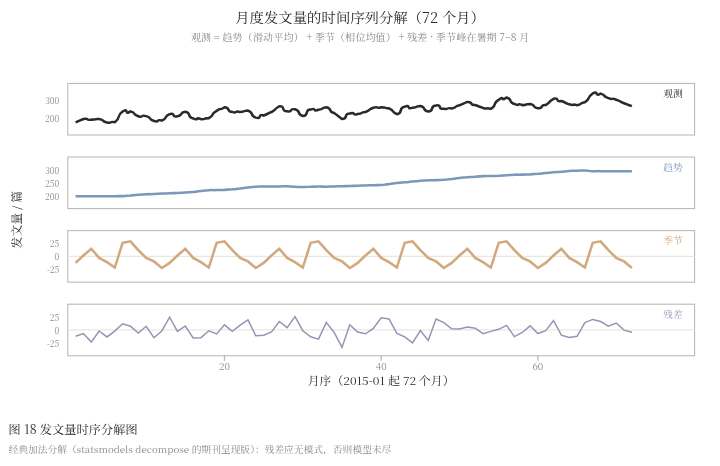

## 快速开始

```bash
git clone https://github.com/gguioo/scholarchart.git
cd scholarchart
# 方式一：直接双击 index.html（零依赖）
# 方式二：本地服务（推荐，样例数据全量加载）
python3 -m http.server 8000
```

或直接用在线版：<https://gguioo.github.io/scholarchart/>（功能与本地版完全一致）。

右侧面板：选样例 → 改幅面/配色 → 编辑 JSON 数据 → 导出。

### 导出 PDF

点击 **PDF · 矢量**，在弹出的打印窗口选"另存为 PDF"（Chrome / Edge / Safari 均支持）。输出为矢量 PDF，文字可检索、字体已嵌入、页面尺寸精确到毫米。

## 数据格式

所有图表用同一 JSON 结构（`type` + `data` + `opts`）：

```jsonc
{
  "type": "trend",
  "data": {
    "x": { "categories": ["2015", "2016"], "label": "年份" },
    "y": { "label": "发文量 / 篇" },
    "series": [{ "name": "庄子", "values": [412, 438] }]
  },
  "opts": {
    "title": "主标题",
    "subtitle": "副标题",
    "figLabel": "图 1",           // 期刊图号
    "figTitle": "四子研究年度发文量",
    "note": "数据来源：……"
  }
}
```

各类型完整字段见 [`samples/`](samples/) 目录十七个样例，复制即可改。

## 学术规范清单

- [x] 矢量输出（PDF / SVG），投稿不降质
- [x] 毫米级物理尺寸（Nature 单栏 89mm / 双栏 183mm 均可微调 JSON 预设）
- [x] 色盲安全配色（Okabe-Ito 柔化系）
- [x] 图号 + 图注 + 数据来源注（期刊三件套）
- [x] 仅左/下轴刺的极简坐标（去箱线）
- [x] 误差棒支持（±SD / ±SE）

## 目录结构

```
scholarchart/
├── index.html          # 应用外壳（唯一入口）
├── src/
│   ├── app.js          # 应用逻辑：切换/预设/编辑/导出
│   ├── export.js       # SVG / PNG / PDF 导出管线
│   ├── fallback.js     # file:// 直开兜底
│   ├── core/           # 坐标系、比例尺、配色、提示
│   └── charts/         # 十七个图表引擎（每个一个文件）
├── samples/            # 十八套样例数据（JSON）
└── assets/             # 截图
```

## License

MIT
